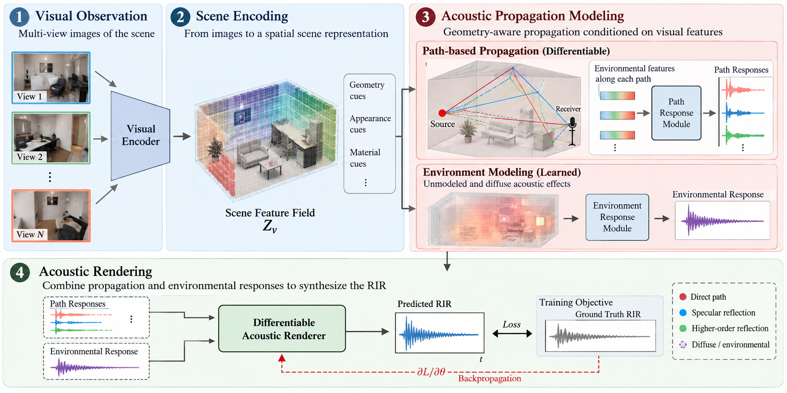
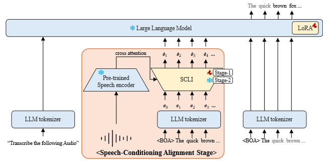
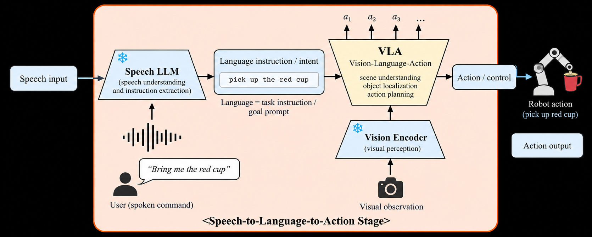
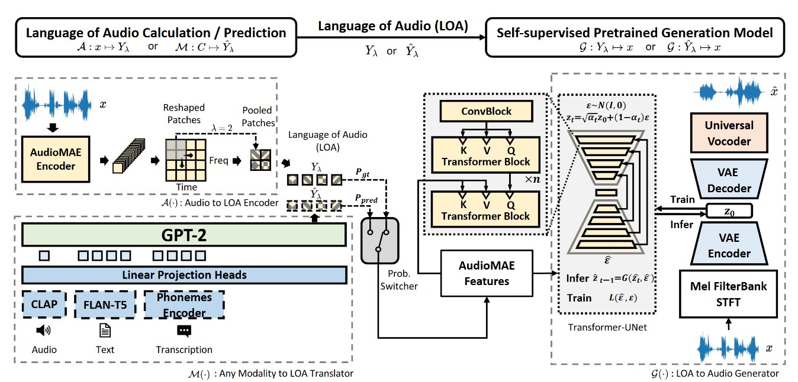
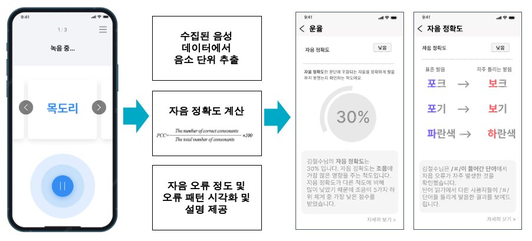
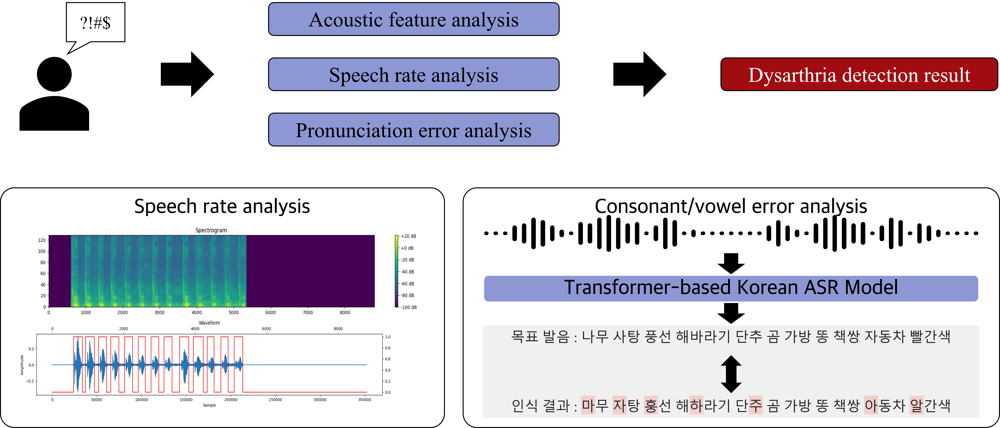
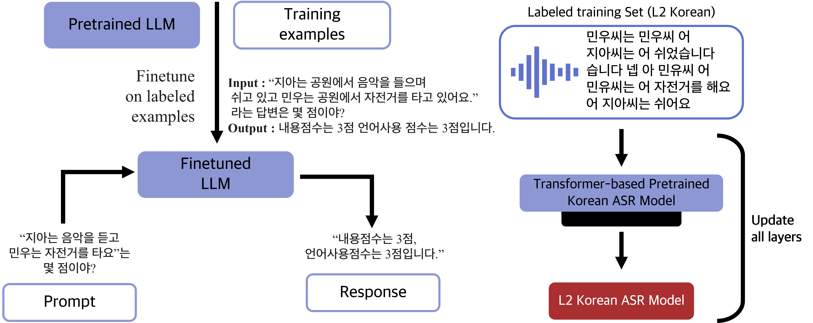
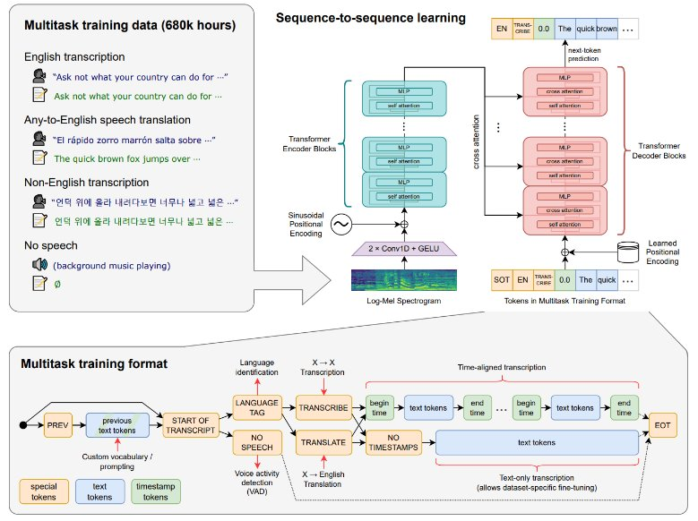
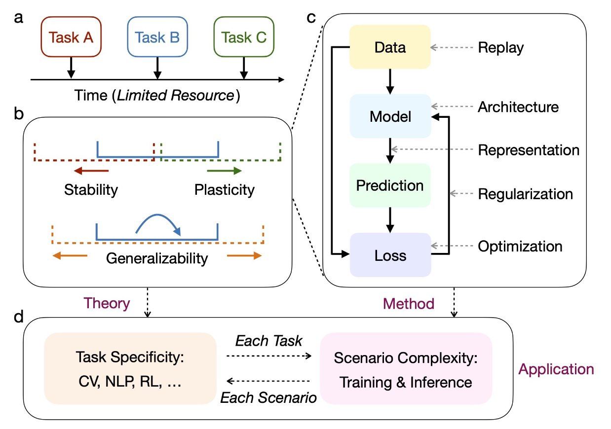

# Research

## 1. Sound World Model for Physical AI

---

- 소리를 통해 물리 공간의 음원, 객체 및 환경을 인지하고 공간적, 의미적 관계를 이해
- Sound Source Localization/Acoustic Scene Understanding/Spatial Audio Modeling

{: style="width: 90%; display: block; margin: 20px auto;"}

## 2. Speech-LLM

---

- 사전 학습된 Speech Encoder를 사용하여 음성을 LLM의 언어 공간에 직접 정렬
- 텍스트 변환 없이 음성 고유의 운율, 감정 정보를 활용하여 End-to-End 추론 수행

{: style="width: 90%; display: block; margin: 20px auto;"}

## 3. On-device Speech-LLM for Physical AI

---

- 실시간 반응성과 제한된 자원을 갖는 로봇 환경에서는 Speech-LLM의 경량화가 요구됨
- Speech-LLM을 경량화하여 로봇 환경에서 음성 지시를 효율적으로 이해하고, VLA를 통해 행동을 생성

{: style="width: 90%; display: block; margin: 20px auto;"}

## 4. Multimodal Video-to-Audio Synthesis

---

- 영상 이벤트와 정밀하게 동기화된 Foley/SFX 자동 생성
- Diffusion 모델 기반의 고품질 오디오 생성 기술 연구
- 텍스트 및 시각적 의미 정보를 활용한 사운드 뉘앙스 제어

{: style="width: 90%; display: block; margin: 20px auto;"}

Liu, H., Yuan, Y., Liu, X. et al. AudioLDM 2: Learning Holistic Audio Generation with Self-Supervised Pretraining. IEEE/ACM Transactions on Audio, Speech, and Language Processing 32, 2871–2883 (2024).

## 5. 음성 명료도 평가 및 설명가능한 인공지능 기법 연구

---

### 1) Explainable AI (XAI) for Digital Healthcare in Post-stroke Dysarthria

- 음향학적 자질을 이용한 말 장애 판별
- 음성 인식을 이용한 말 장애 오류 유형/구간 분석

{: style="width: 90%; display: block; margin: 20px auto;"}

{: style="width: 90%; display: block; margin: 20px auto;"}

### 2) LLM & ASR for L2 Korean

- 외국인 한국어 발화자의 한국어 음성인식
- LLM을 이용한 말하기 내용/언어사용 점수 평가

{: style="width: 90%; display: block; margin: 20px auto;"}

## 6. End-to-End 방식의 음성인식 시스템

---

### 1) E2E 방식의 한국어 음성인식 모델 연구

- E2E 방식과 WFST의 결합을 통한 인식 성능, 속도 향상

{: style="width: 90%; display: block; margin: 20px auto;"}

OpenAI/Whisper (2022)

### 2) Continual Learning for ASR

- Continual Learning 기법을 적용하여, 데이터가 연속적으로 추가되는 환경에서도 안정적인 성능을 유지하는 ASR 모델 연구

{: style="width: 90%; display: block; margin: 20px auto;"}
